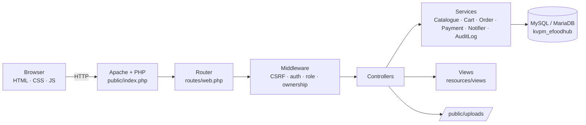
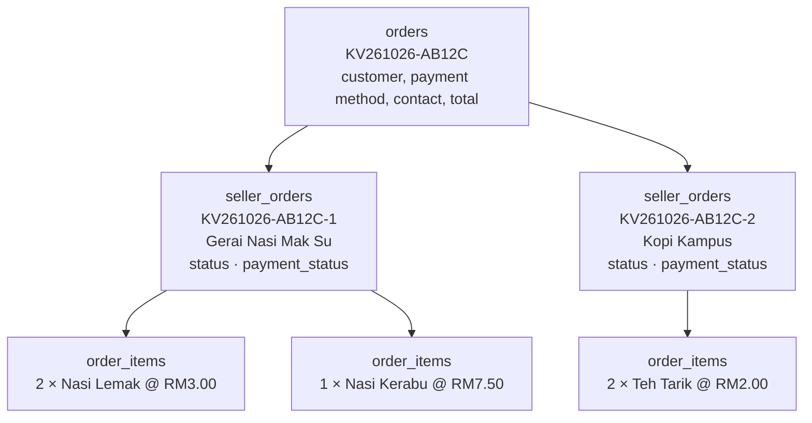
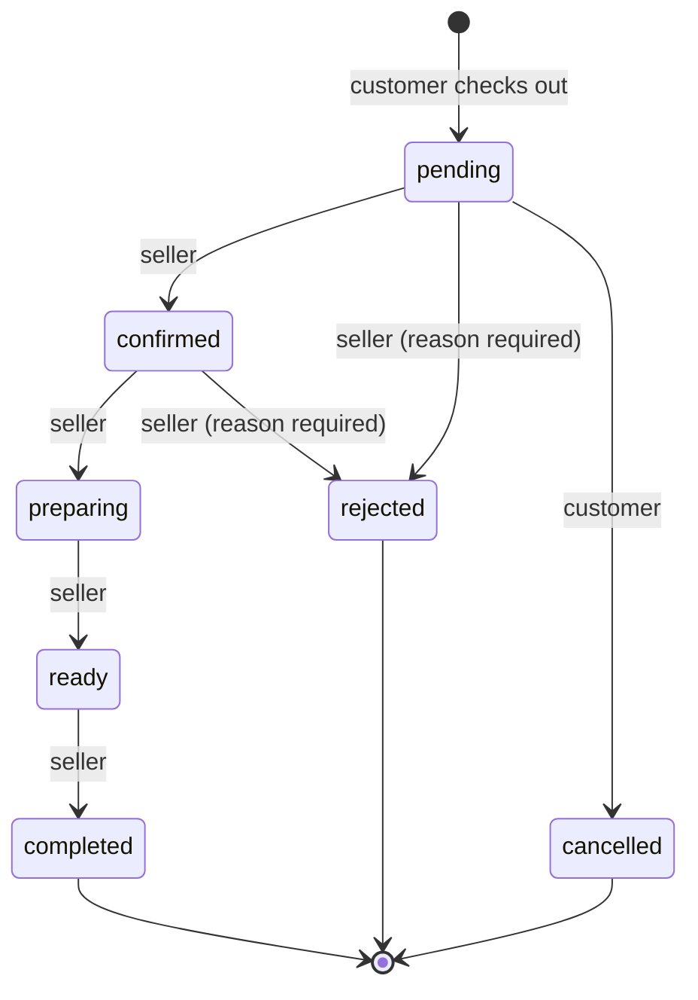

# Architecture and business rules

## 1. System architecture

A classic three-tier web application. Every request enters through one front controller.

### Request lifecycle

1. `public/index.php` sends security headers, loads `app/bootstrap.php` (autoloader, `.env`, config, database connection) and starts a hardened session.
2. `Router::dispatch()` matches the path. **Every POST** is checked for a valid CSRF token before anything else runs.
3. The route's middleware runs: `guest`, `auth`, `shopper` (customer or seller), `seller` (approved shop), `admin`.
4. The controller validates input, enforces **ownership** (e.g. `WHERE id = ? AND seller_id = ?`) and calls services.
5. Services run business rules, using database transactions where several tables change together.
6. The view renders with every dynamic value passed through `e()` (HTML escaping).
7. Errors become friendly pages: `HttpException` → 403/404/405/419 page; anything else is logged to `storage/logs/app.log` and shown as a generic 500 page.

### Main components

| Component | File | Responsibility |
|---|---|---|
| Router | `app/Core/Router.php` | URL patterns, CSRF check on POST, middleware |
| Middleware | `app/Core/Middleware.php` | Role-based access control |
| Auth | `app/Core/Auth.php` | Current user (re-read every request), login with session regeneration |
| Database | `app/Core/Database.php` | PDO, prepared statements, transactions, row locks |
| Validator | `app/Core/Validator.php` | Server-side validation rules |
| ImageUpload | `app/Core/ImageUpload.php` | Safe image uploads |
| Catalogue | `app/Services/Catalogue.php` | Public visibility rule, search, filters, sorting |
| CartService | `app/Services/CartService.php` | Cart with live price/stock checks |
| OrderService | `app/Services/OrderService.php` | Checkout, status workflow, stock |
| PaymentService | `app/Services/PaymentService.php` | Simulated online payment |
| Notifier / AuditLog | `app/Services/*` | In-app notifications, audit trail |

## 2. User roles

| Role | How you get it | Can |
|---|---|---|
| Visitor | — | Browse catalogue, shops, product pages |
| Customer (`customer`) | Public registration | Cart, checkout, orders, reviews, wishlist, apply to sell |
| Seller (`seller`) | Administrator approves a shop application | Everything a customer can, plus their own shop's products, orders and reports |
| Administrator (`admin`) | `database/create_admin.php`, or promoted by another admin with password re-confirmation | Admin dashboard; cannot shop |

Registration always creates a `customer`. A role field sent in the form is ignored (tested: TC-AUTH-04).

## 3. Order model (multi-seller)

The project uses the **preferred multi-seller model**: one checkout may contain products from several shops.

- The **customer** sees one order with one "slip" per shop.
- Each **seller** sees only their own `seller_orders` row, its items, and the contact name/phone/notes needed to fulfil it.
- Status and payment status live on `seller_orders`, so each shop progresses independently.
- `order_items` store a snapshot of name and unit price, so later price changes never alter past orders.

## 4. Order status workflow

| From | Seller may move to | Customer may move to | Administrator may move to |
|---|---|---|---|
| pending | confirmed, rejected | cancelled | any later status, cancelled |
| confirmed | preparing, rejected | — | any later status, cancelled |
| preparing | ready | — | any later status, cancelled |
| ready | completed | — | completed, cancelled |
| completed / rejected / cancelled | — (final) | — | — (final) |

Extra rules:

- An order paid by **simulated online payment** cannot be confirmed by the seller until it is paid.
- **Rejecting** needs a reason, which is shown to the customer.
- **Administrator changes** always need a reason and are written to `audit_logs`.
- Every change is stored in `order_status_history` (who, role, when, note) and triggers a notification.
- The transition is checked in `OrderService::transition()` inside a transaction with the row locked, so two people cannot change the same order at once.

## 5. Stock rules

| Moment | What happens |
|---|---|
| Add to cart / change quantity | Quantity must be ≤ current stock and ≤ `max_quantity_per_item` (default 20). Stock is **not** reserved. |
| Cart page | Each line is re-checked; problems (sold out, not enough stock, product withdrawn) are shown and checkout is disabled until fixed. |
| Checkout | Inside one transaction: product rows are locked (`SELECT … FOR UPDATE` on MySQL), every line is re-validated, then `UPDATE products SET stock = stock - q WHERE id = ? AND stock >= q`. If any update affects 0 rows the whole checkout rolls back. Stock can never go negative (also a `CHECK (stock >= 0)` constraint). |
| Rejected or cancelled | Stock is returned once. `seller_orders.stock_restored` prevents a second restore (tested: TC-ORD-02). |
| Low stock | When a sale takes stock to the threshold (setting `low_stock_threshold`, default 5) the seller is notified. |

## 6. Payment rules

| Method | Flow | Records |
|---|---|---|
| Cash on collection (`cash`) | Order placed → seller completes the order when the customer collects and pays | A `payments` row (`CASH-…`) is created when the seller marks the order **completed**; payment status becomes `paid` |
| Online, simulated (`online_sim`) | After checkout the customer is sent to a demo payment page with two buttons: "simulate success" / "simulate failure" | Each attempt creates a `payments` row (`SIM-…`) with `success` or `failed`. Success marks all still-pending parts `paid` |

- The simulated page is labelled as a simulation and never asks for card numbers, CVV, banking passwords or TAC/OTP.
- Double payment is prevented: the order row is locked and only `pending` + `unpaid` parts can be paid (tested: TC-PAY-03).
- If a **paid** order is later rejected or cancelled, payment status becomes `refund_due`. **No automatic refund exists**; it must be settled manually and noted by an administrator.
- Placing an order is never counted as a sale. Seller and admin sales figures only include `completed` seller orders.

## 7. Visibility and approval rules

A product is shown to the public only when **all** of these are true:

- `products.approval_status = 'approved'` and `archived_at IS NULL`
- its shop (`seller_profiles.status`) is `approved`
- the shop owner's account is `active`
- its category is visible

It can be bought when it is also `is_available = 1` and `stock > 0`.

- New products start as `pending` when the setting **require_product_approval** is on (default), otherwise `approved`.
- Editing the **name or description** of an approved product sends it back to `pending` (price/stock changes do not).
- Editing a **rejected** product resubmits it.
- Suspending a shop hides all its products at once without changing each product.
- Sellers archive (soft delete) products; products are never hard-deleted because past orders reference them.

## 8. Notifications

In-app only. Events: order placed (customer + each seller), confirmed, preparing, ready, completed, rejected, cancelled, simulated payment received (seller), low stock (seller), shop application (admins), shop approved/rejected/suspended, product pending (admins), product approved/rejected/suspended, product reported (admins), role changed.

## 9. Assumptions made

| Topic | Decision | Why |
|---|---|---|
| Fulfilment | Collection at the stall only | Simplest correct option for a campus; delivery needs addresses, fees and riders |
| Guest checkout | Not allowed; the cart needs an account | Keeps orders tied to a contactable person and the cart server-side |
| Seller application | The seller profile row doubles as the application (`status = pending`) | Avoids a separate table with duplicate fields |
| Sellers shopping | Sellers can buy from other shops, not their own | Sellers are students too |
| Variants | Not implemented | Kept out of scope to keep stock logic reliable; options go in descriptions/notes |
| Language | Interface in Bahasa Melayu; documentation in English | Matches the users and the brief |
| Timezone | All timestamps stored in Asia/Kuala_Lumpur | One timezone for the whole campus |
| Password recovery | Administrator issues a one-time temporary password | No e-mail service is configured |

## 10. Requirement checklist

Evidence column refers to automated test IDs in [TESTING.md](TESTING.md) (run on SQLite) or to code. "Manual" means it must still be confirmed by hand on XAMPP/MySQL.

| Requirement | Status | Evidence |
|---|---|---|
| Registration and authentication | Done | TC-AUTH-01…08 |
| Catalogue from database, search, filters, sort, pagination | Done | TC-CAT-01…05 |
| Product details, gallery, reviews, related | Done | Manual + screenshots |
| Shopping cart (server-side) | Done | TC-CART-01…04 |
| Checkout validates products and stock, transaction | Done | TC-CHK-01…04 |
| Orders persist; customers see only their own | Done | TC-ORD-01…03 |
| Seller access control; own products and orders only | Done | TC-SEL-03, TC-SEL-08 |
| Product uploads validated | Done | TC-SEL-05, TC-SEL-06 |
| Stock updated and restored correctly | Done | TC-CHK-01, TC-ORD-02, TC-SEL-04, TC-ADM-08 |
| Seller order workflow | Done | TC-SEL-01, TC-SEL-02, TC-SEL-04 |
| Seller analytics from real data | Done | TC-SEL-09 |
| Administrator access protected | Done | TC-ADM-01 |
| User management, seller approval, moderation, categories, order oversight | Done | TC-ADM-02…10 |
| Important admin actions logged | Done | TC-ADM-02, 03, 06, 08 |
| Simulated payment, no duplicate processing | Done | TC-PAY-01…04 |
| Reviews restricted to completed purchases | Done | TC-REV-01, 02 |
| Notifications | Done | TC-NOT-01 |
| Prepared statements, CSRF, XSS, headers | Done | TC-SEC-01…06, code review |
| Responsive layout | Done | Screenshots at 1366px and 390px; manual check on a phone recommended |
| Works on MySQL/MariaDB under XAMPP | **Manual check needed** | Not executed in the build environment (no MySQL available there) |

## Roadmap

Ordered by value for the effort, after the MySQL verification:

1. **Run the manual XAMPP checklist** in [TESTING.md](TESTING.md) and record results.
2. Printable receipt / collection slip (the order page already prints cleanly with the browser's print).
3. Product variants (e.g. "panas / ais", sizes) with per-variant stock.
4. Seller replies to reviews and a simple customer–seller message thread.
5. QR code on the order slip for collection verification.
6. Configurable collection points and pickup time slots.
7. English/Malay language switch (strings would need to move into language files).
8. Real e-mail notifications and password-reset links (needs an SMTP service).
9. Real payment gateway (e.g. FPX via a licensed provider) — only with proper merchant setup.
