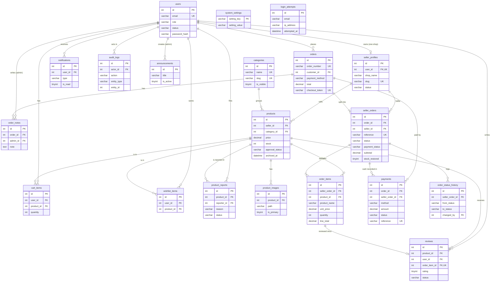

# Database design

- **Engine:** MySQL 8 / MariaDB 10.4+ (InnoDB, utf8mb4)
- **Database name:** `kvpm_efoodhub`
- **Scripts:** `database/schema.sql` (structure + default settings), `database/seed.sql` (demo data, generated by `database/seed.php`)
- **Timezone:** all timestamps are stored in Malaysia time (UTC+08:00). The application sets this on every connection.
- **Money:** `DECIMAL(10,2)`; the PHP code calculates in integer sen to avoid floating-point errors.
- **Allowed values** (roles, statuses) are `VARCHAR` columns with `CHECK` constraints rather than `ENUM`, so the same script works on MySQL and MariaDB and values are easy to read in phpMyAdmin.

## 1. Entity relationship diagram



## 2. Tables and their purpose

| Table | Purpose |
|---|---|
| `users` | Every account. `role` is customer, seller or admin; `status` active or suspended. |
| `login_attempts` | Failed sign-ins, used to rate-limit login (5 per e-mail per 15 minutes). |
| `seller_profiles` | A shop. Also acts as the seller application: `pending` → `approved` / `rejected`; can be `suspended`. One per user. |
| `categories` | Product categories; `is_visible` hides a category and its products. |
| `products` | Listings. `approval_status` is set by administrators, `is_available` by the seller, `archived_at` is the soft delete. |
| `product_images` | Up to 5 images per product; one `is_primary`. |
| `cart_items` | The signed-in user's cart (one row per product). Prices are not stored here. |
| `wishlist_items` | Saved products. |
| `orders` | One checkout: customer, contact details, payment method, total at the time, one-time `checkout_token`. |
| `seller_orders` | The part of an order handled by one shop. Holds status, payment status, subtotal and the `stock_restored` guard. |
| `order_items` | Snapshot of each line (name, unit price, quantity, line total). |
| `order_status_history` | Every status change with who made it and why. |
| `order_notes` | Administrator investigation / resolution notes. |
| `payments` | Cash collections (`CASH-…`) and simulated online attempts (`SIM-…`, success or failed). |
| `reviews` | One review per purchased order line; `hidden` by moderation. |
| `notifications` | In-app notifications. |
| `product_reports` | Customer reports about listings and how they were resolved. |
| `announcements` | Homepage notices with optional start/end time. |
| `system_settings` | Key/value settings editable by administrators. |
| `audit_logs` | Record of important administrative actions (never passwords or tokens). |

Tables listed in the brief that were **deliberately not created**: `customer_profiles` (all customer fields fit in `users`), `carts` (one cart per user, so `cart_items.user_id` is enough), `product_variants` (variants are out of scope), `addresses` (collection only, no delivery), `seller_applications` (`seller_profiles.status` covers it).

## 3. Foreign keys and deletion behaviour

| Child → parent | On delete | Reason |
|---|---|---|
| `seller_profiles.user_id` → `users` | RESTRICT | Accounts are suspended, not deleted |
| `products.seller_id` → `seller_profiles` | RESTRICT | Products belong to orders' history |
| `products.category_id` → `categories` | RESTRICT | A category in use cannot be deleted (also checked in the app) |
| `product_images.product_id` → `products` | CASCADE | Images have no meaning without the product |
| `cart_items`, `wishlist_items` → `users` / `products` | CASCADE | Disposable data |
| `orders.customer_id` → `users` | RESTRICT | Order history must survive |
| `seller_orders.order_id` → `orders` | RESTRICT | |
| `seller_orders.seller_id` → `seller_profiles` | RESTRICT | |
| `order_items.seller_order_id` → `seller_orders` | RESTRICT | |
| `order_items.product_id` → `products` | RESTRICT | Products are archived, never deleted |
| `order_status_history.seller_order_id` → `seller_orders` | CASCADE | |
| `order_status_history.changed_by` → `users` | SET NULL | |
| `payments.order_id` / `seller_order_id` → orders | RESTRICT | Financial records are permanent |
| `reviews.*` → products / users / order_items | CASCADE | |
| `notifications.user_id` → `users` | CASCADE | |
| `product_reports.*` → products / users | CASCADE; `resolved_by` SET NULL | |
| `audit_logs.actor_id` → `users` | SET NULL | Keep the log even if an account goes |
| `order_notes.admin_id` → `users` | RESTRICT | |
| `announcements.created_by` → `users` | SET NULL | |

## 4. Data dictionary

Generated from `database/schema.sql` with `php tests/tools/data_dictionary.php`, so it always matches the real schema.

### `users`

| Column | Type | Null | Default | Key / constraint |
|---|---|---|---|---|
| id | INT UNSIGNED | No |  | PK, auto increment |
| name | VARCHAR(100) | No |  |  |
| email | VARCHAR(150) | No |  |  |
| phone | VARCHAR(20) | Yes |  |  |
| password_hash | VARCHAR(255) | No |  |  |
| role | VARCHAR(20) | No | 'customer' |  |
| status | VARCHAR(20) | No | 'active' |  |
| must_change_password | TINYINT(1) | No | 0 |  |
| last_login_at | DATETIME | Yes |  |  |
| created_at | DATETIME | No | CURRENT_TIMESTAMP |  |
| updated_at | DATETIME | No | CURRENT_TIMESTAMP ON UPDATE CURRENT_TIMESTAMP |  |

Unique `email` · Index `role, status` · Check `role IN ('customer', 'seller', 'admin')` · Check `status IN ('active', 'suspended')`

### `login_attempts`

| Column | Type | Null | Default | Key / constraint |
|---|---|---|---|---|
| id | INT UNSIGNED | No |  | PK, auto increment |
| email | VARCHAR(150) | No |  |  |
| ip_address | VARCHAR(45) | No |  |  |
| attempted_at | DATETIME | No |  |  |

Index `email, attempted_at` · Index `ip_address, attempted_at`

### `seller_profiles`

| Column | Type | Null | Default | Key / constraint |
|---|---|---|---|---|
| id | INT UNSIGNED | No |  | PK, auto increment |
| user_id | INT UNSIGNED | No |  | FK → users.id (on delete RESTRICT) |
| shop_name | VARCHAR(100) | No |  |  |
| slug | VARCHAR(120) | No |  |  |
| description | TEXT | Yes |  |  |
| phone | VARCHAR(20) | No |  |  |
| collection_location | VARCHAR(150) | No |  |  |
| collection_hours | VARCHAR(100) | Yes |  |  |
| logo_path | VARCHAR(255) | Yes |  |  |
| status | VARCHAR(20) | No | 'pending' |  |
| review_note | VARCHAR(255) | Yes |  |  |
| reviewed_by | INT UNSIGNED | Yes |  | FK → users.id (on delete SET NULL) |
| reviewed_at | DATETIME | Yes |  |  |
| created_at | DATETIME | No | CURRENT_TIMESTAMP |  |
| updated_at | DATETIME | No | CURRENT_TIMESTAMP ON UPDATE CURRENT_TIMESTAMP |  |

Unique `user_id` · Unique `slug` · Index `status` · Check `status IN ('pending', 'approved', 'rejected', 'suspended')`

### `categories`

| Column | Type | Null | Default | Key / constraint |
|---|---|---|---|---|
| id | INT UNSIGNED | No |  | PK, auto increment |
| name | VARCHAR(60) | No |  |  |
| slug | VARCHAR(80) | No |  |  |
| description | VARCHAR(255) | Yes |  |  |
| image_path | VARCHAR(255) | Yes |  |  |
| is_visible | TINYINT(1) | No | 1 |  |
| sort_order | INT | No | 0 |  |
| created_at | DATETIME | No | CURRENT_TIMESTAMP |  |
| updated_at | DATETIME | No | CURRENT_TIMESTAMP ON UPDATE CURRENT_TIMESTAMP |  |

Unique `name` · Unique `slug`

### `products`

| Column | Type | Null | Default | Key / constraint |
|---|---|---|---|---|
| id | INT UNSIGNED | No |  | PK, auto increment |
| seller_id | INT UNSIGNED | No |  | FK → seller_profiles.id (on delete RESTRICT) |
| category_id | INT UNSIGNED | No |  | FK → categories.id (on delete RESTRICT) |
| name | VARCHAR(120) | No |  |  |
| slug | VARCHAR(150) | No |  |  |
| description | TEXT | Yes |  |  |
| price | DECIMAL(10,2) | No |  |  |
| stock | INT | No | 0 |  |
| sku | VARCHAR(40) | Yes |  |  |
| is_available | TINYINT(1) | No | 1 |  |
| approval_status | VARCHAR(20) | No | 'pending' |  |
| moderation_note | VARCHAR(255) | Yes |  |  |
| archived_at | DATETIME | Yes |  |  |
| created_at | DATETIME | No | CURRENT_TIMESTAMP |  |
| updated_at | DATETIME | No | CURRENT_TIMESTAMP ON UPDATE CURRENT_TIMESTAMP |  |

Unique `slug` · Index `approval_status, is_available, archived_at` · Index `seller_id` · Index `category_id` · Index `name` · Index `created_at` · Check `price >= 0` · Check `stock >= 0` · Check `approval_status IN ('pending', 'approved', 'rejected', 'suspended')`

### `product_images`

| Column | Type | Null | Default | Key / constraint |
|---|---|---|---|---|
| id | INT UNSIGNED | No |  | PK, auto increment |
| product_id | INT UNSIGNED | No |  | FK → products.id (on delete CASCADE) |
| path | VARCHAR(255) | No |  |  |
| is_primary | TINYINT(1) | No | 0 |  |
| sort_order | INT | No | 0 |  |
| created_at | DATETIME | No | CURRENT_TIMESTAMP |  |

Index `product_id`

### `cart_items`

| Column | Type | Null | Default | Key / constraint |
|---|---|---|---|---|
| id | INT UNSIGNED | No |  | PK, auto increment |
| user_id | INT UNSIGNED | No |  | FK → users.id (on delete CASCADE) |
| product_id | INT UNSIGNED | No |  | FK → products.id (on delete CASCADE) |
| quantity | INT | No |  |  |
| created_at | DATETIME | No | CURRENT_TIMESTAMP |  |
| updated_at | DATETIME | No | CURRENT_TIMESTAMP ON UPDATE CURRENT_TIMESTAMP |  |

Unique `user_id, product_id` · Index `product_id` · Check `quantity > 0`

### `wishlist_items`

| Column | Type | Null | Default | Key / constraint |
|---|---|---|---|---|
| id | INT UNSIGNED | No |  | PK, auto increment |
| user_id | INT UNSIGNED | No |  | FK → users.id (on delete CASCADE) |
| product_id | INT UNSIGNED | No |  | FK → products.id (on delete CASCADE) |
| created_at | DATETIME | No | CURRENT_TIMESTAMP |  |

Unique `user_id, product_id` · Index `product_id`

### `orders`

| Column | Type | Null | Default | Key / constraint |
|---|---|---|---|---|
| id | INT UNSIGNED | No |  | PK, auto increment |
| order_number | VARCHAR(30) | No |  |  |
| customer_id | INT UNSIGNED | No |  | FK → users.id (on delete RESTRICT) |
| payment_method | VARCHAR(20) | No |  |  |
| contact_name | VARCHAR(100) | No |  |  |
| contact_phone | VARCHAR(20) | No |  |  |
| notes | VARCHAR(500) | Yes |  |  |
| total | DECIMAL(10,2) | No |  |  |
| checkout_token | VARCHAR(64) | No |  |  |
| created_at | DATETIME | No | CURRENT_TIMESTAMP |  |
| updated_at | DATETIME | No | CURRENT_TIMESTAMP ON UPDATE CURRENT_TIMESTAMP |  |

Unique `order_number` · Unique `checkout_token` · Index `customer_id, created_at` · Check `payment_method IN ('cash', 'online_sim')` · Check `total >= 0`

### `seller_orders`

| Column | Type | Null | Default | Key / constraint |
|---|---|---|---|---|
| id | INT UNSIGNED | No |  | PK, auto increment |
| order_id | INT UNSIGNED | No |  | FK → orders.id (on delete RESTRICT) |
| seller_id | INT UNSIGNED | No |  | FK → seller_profiles.id (on delete RESTRICT) |
| reference | VARCHAR(40) | No |  |  |
| status | VARCHAR(20) | No | 'pending' |  |
| payment_status | VARCHAR(20) | No | 'unpaid' |  |
| subtotal | DECIMAL(10,2) | No |  |  |
| status_note | VARCHAR(255) | Yes |  |  |
| stock_restored | TINYINT(1) | No | 0 |  |
| confirmed_at | DATETIME | Yes |  |  |
| completed_at | DATETIME | Yes |  |  |
| cancelled_at | DATETIME | Yes |  |  |
| created_at | DATETIME | No | CURRENT_TIMESTAMP |  |
| updated_at | DATETIME | No | CURRENT_TIMESTAMP ON UPDATE CURRENT_TIMESTAMP |  |

Unique `reference` · Index `order_id` · Index `seller_id, status` · Index `created_at` · Check `status IN ('pending', 'confirmed', 'preparing', 'ready', 'completed', 'rejected', 'cancelled')` · Check `payment_status IN ('unpaid', 'paid', 'refund_due', 'void')`

### `order_items`

| Column | Type | Null | Default | Key / constraint |
|---|---|---|---|---|
| id | INT UNSIGNED | No |  | PK, auto increment |
| seller_order_id | INT UNSIGNED | No |  | FK → seller_orders.id (on delete RESTRICT) |
| product_id | INT UNSIGNED | No |  | FK → products.id (on delete RESTRICT) |
| product_name | VARCHAR(120) | No |  |  |
| unit_price | DECIMAL(10,2) | No |  |  |
| quantity | INT | No |  |  |
| line_total | DECIMAL(10,2) | No |  |  |

Index `seller_order_id` · Index `product_id` · Check `quantity > 0`

### `order_status_history`

| Column | Type | Null | Default | Key / constraint |
|---|---|---|---|---|
| id | INT UNSIGNED | No |  | PK, auto increment |
| seller_order_id | INT UNSIGNED | No |  | FK → seller_orders.id (on delete CASCADE) |
| from_status | VARCHAR(20) | Yes |  |  |
| to_status | VARCHAR(20) | No |  |  |
| changed_by | INT UNSIGNED | Yes |  | FK → users.id (on delete SET NULL) |
| actor_role | VARCHAR(20) | No |  |  |
| note | VARCHAR(255) | Yes |  |  |
| created_at | DATETIME | No | CURRENT_TIMESTAMP |  |

Index `seller_order_id, created_at`

### `order_notes`

| Column | Type | Null | Default | Key / constraint |
|---|---|---|---|---|
| id | INT UNSIGNED | No |  | PK, auto increment |
| order_id | INT UNSIGNED | No |  | FK → orders.id (on delete CASCADE) |
| admin_id | INT UNSIGNED | No |  | FK → users.id (on delete RESTRICT) |
| note | TEXT | No |  |  |
| created_at | DATETIME | No | CURRENT_TIMESTAMP |  |

Index `order_id`

### `payments`

| Column | Type | Null | Default | Key / constraint |
|---|---|---|---|---|
| id | INT UNSIGNED | No |  | PK, auto increment |
| order_id | INT UNSIGNED | No |  | FK → orders.id (on delete RESTRICT) |
| seller_order_id | INT UNSIGNED | Yes |  | FK → seller_orders.id (on delete RESTRICT) |
| method | VARCHAR(20) | No |  |  |
| amount | DECIMAL(10,2) | No |  |  |
| status | VARCHAR(20) | No |  |  |
| reference | VARCHAR(40) | No |  |  |
| note | VARCHAR(255) | Yes |  |  |
| created_by | INT UNSIGNED | Yes |  | FK → users.id (on delete SET NULL) |
| created_at | DATETIME | No | CURRENT_TIMESTAMP |  |

Unique `reference` · Index `order_id` · Index `seller_order_id` · Check `method IN ('cash', 'online_sim')` · Check `status IN ('success', 'failed')`

### `reviews`

| Column | Type | Null | Default | Key / constraint |
|---|---|---|---|---|
| id | INT UNSIGNED | No |  | PK, auto increment |
| product_id | INT UNSIGNED | No |  | FK → products.id (on delete CASCADE) |
| user_id | INT UNSIGNED | No |  | FK → users.id (on delete CASCADE) |
| order_item_id | INT UNSIGNED | No |  | FK → order_items.id (on delete CASCADE) |
| rating | TINYINT | No |  |  |
| comment | VARCHAR(1000) | Yes |  |  |
| status | VARCHAR(20) | No | 'published' |  |
| moderation_note | VARCHAR(255) | Yes |  |  |
| created_at | DATETIME | No | CURRENT_TIMESTAMP |  |
| updated_at | DATETIME | No | CURRENT_TIMESTAMP ON UPDATE CURRENT_TIMESTAMP |  |

Unique `order_item_id` · Index `product_id, status` · Index `user_id` · Check `rating BETWEEN 1 AND 5` · Check `status IN ('published', 'hidden')`

### `notifications`

| Column | Type | Null | Default | Key / constraint |
|---|---|---|---|---|
| id | INT UNSIGNED | No |  | PK, auto increment |
| user_id | INT UNSIGNED | No |  | FK → users.id (on delete CASCADE) |
| type | VARCHAR(40) | No |  |  |
| title | VARCHAR(150) | No |  |  |
| message | VARCHAR(500) | No |  |  |
| link | VARCHAR(255) | Yes |  |  |
| is_read | TINYINT(1) | No | 0 |  |
| created_at | DATETIME | No | CURRENT_TIMESTAMP |  |

Index `user_id, is_read, created_at`

### `product_reports`

| Column | Type | Null | Default | Key / constraint |
|---|---|---|---|---|
| id | INT UNSIGNED | No |  | PK, auto increment |
| product_id | INT UNSIGNED | No |  | FK → products.id (on delete CASCADE) |
| reporter_id | INT UNSIGNED | No |  | FK → users.id (on delete CASCADE) |
| reason | VARCHAR(30) | No |  |  |
| details | VARCHAR(500) | Yes |  |  |
| status | VARCHAR(20) | No | 'open' |  |
| resolution_note | VARCHAR(255) | Yes |  |  |
| resolved_by | INT UNSIGNED | Yes |  | FK → users.id (on delete SET NULL) |
| resolved_at | DATETIME | Yes |  |  |
| created_at | DATETIME | No | CURRENT_TIMESTAMP |  |

Index `status, created_at` · Index `product_id` · Check `reason IN ('inaccurate', 'prohibited', 'offensive', 'scam', 'other')` · Check `status IN ('open', 'resolved', 'dismissed')`

### `announcements`

| Column | Type | Null | Default | Key / constraint |
|---|---|---|---|---|
| id | INT UNSIGNED | No |  | PK, auto increment |
| title | VARCHAR(150) | No |  |  |
| body | VARCHAR(500) | No |  |  |
| is_active | TINYINT(1) | No | 1 |  |
| starts_at | DATETIME | Yes |  |  |
| ends_at | DATETIME | Yes |  |  |
| created_by | INT UNSIGNED | Yes |  | FK → users.id (on delete SET NULL) |
| created_at | DATETIME | No | CURRENT_TIMESTAMP |  |
| updated_at | DATETIME | No | CURRENT_TIMESTAMP ON UPDATE CURRENT_TIMESTAMP |  |

Index `is_active`

### `system_settings`

| Column | Type | Null | Default | Key / constraint |
|---|---|---|---|---|
| setting_key | VARCHAR(60) | No |  | PK |
| setting_value | VARCHAR(500) | No |  |  |
| updated_at | DATETIME | No | CURRENT_TIMESTAMP ON UPDATE CURRENT_TIMESTAMP |  |

### `audit_logs`

| Column | Type | Null | Default | Key / constraint |
|---|---|---|---|---|
| id | INT UNSIGNED | No |  | PK, auto increment |
| actor_id | INT UNSIGNED | Yes |  | FK → users.id (on delete SET NULL) |
| action | VARCHAR(60) | No |  |  |
| entity_type | VARCHAR(40) | No |  |  |
| entity_id | INT UNSIGNED | Yes |  |  |
| details | TEXT | Yes |  |  |
| ip_address | VARCHAR(45) | Yes |  |  |
| created_at | DATETIME | No | CURRENT_TIMESTAMP |  |

Index `created_at` · Index `entity_type, entity_id` · Index `actor_id`

### Default settings (`system_settings`)

| Key | Default | Meaning |
|---|---|---|
| `require_product_approval` | `1` | New products must be approved by an administrator |
| `low_stock_threshold` | `5` | Stock at or below this is "low"; sellers are notified |
| `max_quantity_per_item` | `20` | Maximum units of one product per order |
| `allow_online_sim_payment` | `1` | Show the simulated online payment option |
| `contact_email`, `contact_phone` | example values | Shown in the footer and help pages |
| `collection_info` | Malay text | Shown at checkout |

## 5. Backup and restore

### Backup with phpMyAdmin

1. Open <http://localhost/phpmyadmin>, select `kvpm_efoodhub`.
2. **Export** → method *Quick*, format *SQL* → **Export**.
3. Also copy the folder `public/uploads/` — images are files, not database rows.

### Backup from the command line

```
C:\xampp\mysql\bin\mysqldump.exe -u root --single-transaction --routines kvpm_efoodhub > backup-2026-10-26.sql
```

### Restore

1. In phpMyAdmin create an empty database `kvpm_efoodhub` (collation `utf8mb4_unicode_ci`) if it does not exist.
2. Select it → **Import** → choose the backup `.sql` file.
3. Copy the saved `public/uploads/` folder back.

```
C:\xampp\mysql\bin\mysql.exe -u root kvpm_efoodhub < backup-2026-10-26.sql
```

Keep backups somewhere other than the laptop (for example a USB drive or cloud storage), and never commit them to a public GitHub repository — they contain personal data and password hashes.

## Upgrading an existing database

`schema.sql` is a **fresh-install** script: it drops all tables. Never run it against a database with data you want to keep.

When the schema changes in future:

1. Back up first (section 5).
2. Write a small migration file in `database/migrations/`, e.g. `2026_11_01_add_pickup_time.sql`, containing only `ALTER TABLE …` statements.
3. Run it on a copy of the database first, check the site, then run it on the real one.
4. Update `schema.sql` so fresh installs get the same structure, and regenerate the data dictionary.

No migrations exist yet; version 1.0 is the initial schema.
